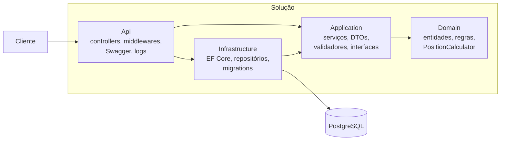

# InvestWallet

API REST de **carteira de investimentos**: registra carteiras, ativos e transações de compra/venda e calcula a **posição** atual e o **preço médio** de cada ativo. Projeto de portfólio em **C# / .NET 8** com PostgreSQL, testes automatizados, Docker e CI.

> Foco do projeto: um CRUD pequeno, mas feito como em produção: regras de negócio no domínio, validação em camadas, erros padronizados, logs rastreáveis, proteção contra concorrência, testes de verdade (inclusive contra um banco real) e documentação que não fica velha.

## Stack

| Área | Tecnologia |
|---|---|
| Linguagem / framework | C# 12, .NET 8, ASP.NET Core (controllers) |
| Banco | PostgreSQL 16, EF Core 8 (migrations), Npgsql |
| Validação | FluentValidation |
| Logs | Serilog (texto em dev, JSON em produção), `traceId` por requisição |
| Documentação | Swagger / OpenAPI (Swashbuckle) |
| Testes | xUnit, NSubstitute, Testcontainers (PostgreSQL real) |
| Entrega | Docker (multi-stage, usuário não-root), Docker Compose, GitHub Actions |

## Como executar

### Opção A: tudo em Docker (recomendada)
Requer Docker.
```bash
cp .env.example .env            # ajuste POSTGRES_PASSWORD se quiser
docker compose up --build       # sobe PostgreSQL + API; cria as tabelas sozinho
```
- API: <http://localhost:8080> · Swagger: <http://localhost:8080/swagger> · Liveness: <http://localhost:8080/health> · Readiness (consulta o banco): <http://localhost:8080/health/ready>
- Para parar: `docker compose down` (os dados ficam no volume; `down -v` apaga tudo).

### Opção B: API no seu computador, banco em Docker
Requer .NET 8 SDK e Docker.
```bash
cp .env.example .env
docker compose up -d db                      # só o PostgreSQL
set -a; source .env; set +a                  # exporta as variáveis (ConnectionStrings__Default etc.)
dotnet tool restore                          # instala o dotnet-ef (uma vez)
dotnet ef database update --project src/InvestWallet.Infrastructure --startup-project src/InvestWallet.Api
dotnet run --project src/InvestWallet.Api    # Swagger em /swagger (Development)
```

### Experimente
```bash
B=http://localhost:8080
W=$(curl -s -X POST $B/api/wallets -H 'Content-Type: application/json' -d '{"name":"Aposentadoria"}' | python3 -c 'import sys,json;print(json.load(sys.stdin)["id"])')
A=$(curl -s -X POST $B/api/assets  -H 'Content-Type: application/json' -d '{"ticker":"PETR4","name":"Petrobras PN","type":"Stock"}' | python3 -c 'import sys,json;print(json.load(sys.stdin)["id"])')

curl -X POST $B/api/wallets/$W/transactions -H 'Content-Type: application/json' \
  -d "{\"assetId\":\"$A\",\"type\":\"Buy\",\"quantity\":10,\"unitPrice\":35.5,\"executedAt\":\"2026-01-15T13:30:00Z\"}"

curl $B/api/wallets/$W/positions        # quantidade 10, preço médio 35.5
curl -X POST $B/api/wallets/$W/transactions -H 'Content-Type: application/json' \
  -d "{\"assetId\":\"$A\",\"type\":\"Sell\",\"quantity\":99,\"unitPrice\":40,\"executedAt\":\"2026-02-01T13:30:00Z\"}"   # 422: vende mais do que possui
```

## Endpoints

| Recurso | Rotas |
|---|---|
| Carteiras | `GET/POST /api/wallets` · `GET/PUT/DELETE /api/wallets/{id}` |
| Ativos | `GET/POST /api/assets` · `GET/PUT/DELETE /api/assets/{id}` |
| Transações | `GET/POST /api/wallets/{walletId}/transactions` · `GET/DELETE /api/wallets/{walletId}/transactions/{id}` |
| Posição | `GET /api/wallets/{walletId}/positions` |
| Saúde | `GET /health` (liveness, o processo está de pé) · `GET /health/ready` (readiness, inclui o banco; 503 se falhar) |

Listagens são paginadas (`page`, `pageSize`, máximo 100); transações aceitam filtros `assetId`, `from` e `to`. Detalhes, exemplos e todas as respostas de erro estão no Swagger.

## Regras de negócio
- Quantidade e preço devem ser maiores que zero (até 12 dígitos inteiros e 6 casas decimais); a data não pode estar no futuro.
- **Não é possível vender mais do que se possui**, considerando a ordem cronológica: vender "antes" de uma compra é recusado.
- **Preço médio** considera apenas compras; vendas reduzem a quantidade sem alterá-lo. Zerar a posição reinicia o cálculo.
- Remover uma transação só é aceito se o histórico restante continuar válido (não dá para apagar a compra que sustenta uma venda posterior).
- Ticker é único e gravado em maiúsculas. Ativo ou carteira com transações não podem ser excluídos.
- Operações simultâneas sobre o mesmo ativo na mesma carteira são serializadas, então o saldo nunca fica negativo.

## Erros
Sempre `application/problem+json` (RFC 7807) com `traceId`:

| Status | Significado |
|---|---|
| 400 | Requisição inválida (campo ausente, formato, limite). `errors` lista todos os campos |
| 404 | Recurso da URL não existe |
| 409 | Conflito com o estado atual (ticker duplicado, excluir algo com dependentes) |
| 422 | Regra de negócio violada (ex.: venda maior que a posição) |
| 500 | Erro inesperado; mensagem genérica, detalhe só no log |

Para investigar um erro, procure o `traceId` da resposta nos logs: todas as linhas daquela requisição o carregam.

## Arquitetura



As dependências apontam para o núcleo: o **Domain não conhece** banco nem HTTP, por isso as regras são testadas em milissegundos, sem infraestrutura.

```
src/
  InvestWallet.Domain/          entidades, enums, PositionCalculator (função pura)
  InvestWallet.Application/     serviços, DTOs, validadores, interfaces de repositório
  InvestWallet.Infrastructure/  AppDbContext, repositórios, migrations
  InvestWallet.Api/             controllers, tratamento de erros, Swagger, Serilog
tests/
  InvestWallet.UnitTests/         74 testes, sem banco
  InvestWallet.IntegrationTests/  88 testes: API real + PostgreSQL descartável
docs/                           requisitos, modelo de dados, endpoints, ADRs, guia de estudo
```

### Decisões de arquitetura (ADRs em [`docs/adr`](docs/adr))
1. [Camadas e stack](docs/adr/0001-camadas-e-stack.md)
2. [Posição derivada do histórico, não armazenada](docs/adr/0002-posicao-derivada-do-historico.md)
3. [Concorrência com advisory lock do PostgreSQL](docs/adr/0003-concorrencia-com-advisory-lock.md)
4. [Migrations aplicadas na subida, atrás de uma flag](docs/adr/0004-migrations-na-subida-da-aplicacao.md)
5. [Convenção de códigos de erro HTTP](docs/adr/0005-codigos-de-erro-http.md)
6. [Rastreamento de erros com Sentry (opcional)](docs/adr/0006-rastreamento-de-erros-com-sentry.md)

## Testes
```bash
dotnet test                                      # tudo
dotnet test tests/InvestWallet.UnitTests         # rápidos, sem Docker (~0,3 s)
dotnet test tests/InvestWallet.IntegrationTests  # sobem um PostgreSQL descartável (exige Docker)
```
- Os testes de integração **não** usam o banco do `docker compose`: cada execução cria e destrói o próprio container, com as migrations reais.
- Cobrem fluxos completos, formato de erro, paginação, fusos horários e **corridas reais** (8 vendas simultâneas sobre saldo 20: exatamente 2 passam; 8 criações do mesmo ticker: 1 criada, 7 conflitos).
- Há testes de **contrato** sobre o `swagger.json`: o documento é válido, expõe exatamente os endpoints planejados e documenta todas as respostas, então a documentação não envelhece em silêncio.
- Cobertura de linhas medida: **98,9%** (somando as duas suítes, sem código gerado: migrations e o regex gerado pelo compilador; com o regex gerado incluído, 93,5%). Como cobertura só mostra o que foi *executado*, a eficácia dos testes foi verificada quebrando proteções de propósito (trava de concorrência, ordenação cronológica, tradução de erros, documentação, vazamento no 500) e confirmando que os testes certos falham.

## CI (GitHub Actions)
[`.github/workflows/ci.yml`](.github/workflows/ci.yml) roda a cada push/PR para `main`:
1. **Build e testes:** `dotnet build -warnaserror` (qualquer warning quebra) e as duas suítes de teste.
2. **Imagem Docker e smoke test:** constrói a imagem, sobe API + banco com `docker compose`, e confere `/health`, o Swagger e um `POST` real.

## Logs
- **Development:** texto legível no console, com o `TraceId` em cada linha. Para ver o SQL do EF, configure `Microsoft.EntityFrameworkCore.Database.Command` como `Information` em `appsettings.Development.json`.
- **Demais ambientes (inclusive o container):** JSON, um evento por linha, pronto para coleta.
- Nunca são registrados corpos de requisição nem valores de parâmetros SQL.

## Rastreamento de erros (Sentry, opcional)
Desligado por padrão: sem DSN, nada sai da aplicação. Para ativar, crie um projeto gratuito no [Sentry](https://sentry.io) e coloque o DSN no seu `.env` (ignorado pelo Git):
```bash
SENTRY_DSN=https://<chave>@o<n>.ingest.sentry.io/<n>
docker compose up --build                       # o compose repassa SENTRY_DSN para a API
# ou, rodando a API localmente:  Sentry__Dsn="$SENTRY_DSN" dotnet run --project src/InvestWallet.Api
```
Para ver um erro chegar: `docker compose stop db`, chame `GET /api/wallets` (resposta 500) e depois `docker compose start db`. O evento no Sentry traz a tag `trace_id`, a mesma do log e da resposta.

- **Só erros 500** vão para o Sentry; 400, 404, 409 e 422 são comportamento esperado e ficam de fora.
- **Não vão:** corpo de requisição, cookies, cabeçalhos de autenticação, IP, o nome da máquina (`server_name` e `SERVER_NAME` viram `investwallet-api`) nem o seu usuário do sistema (caminhos como `/home/ana/...` viram `~/...`, nos stack frames e nas imagens de debug). Trechos como `Password=...` ou `Authorization: Bearer ...` em mensagens de exceção são removidos antes do envio.
- **Ainda vai** um identificador anônimo de instalação (`user.id`, um UUID gerado pelo SDK e gravado em `~/.local/share/Sentry`) e o `release` com o hash do commit.
- O comportamento é coberto por testes **sem rede** (transporte simulado) e foi **verificado com envio real** (ver `docs/REVISAO-FINAL.md`). A entrega real não é testada no CI, pois depende de um DSN. Decisão em [ADR 0006](docs/adr/0006-rastreamento-de-erros-com-sentry.md).

## Configuração
| Variável | Para quê | Padrão |
|---|---|---|
| `ConnectionStrings__Default` | Conexão com o PostgreSQL | (obrigatória) |
| `Database__MigrateOnStartup` | Aplica migrations ao subir | `false` (o compose liga) |
| `Swagger__Enabled` | Expõe o Swagger fora de Development | `false` (o compose liga) |
| `Sentry__Dsn` (no compose: `SENTRY_DSN`) | Ativa o rastreamento de erros no Sentry | vazio = desativado |

## Limitações conhecidas e próximos passos
- **Sem HTTPS, CORS e rate limiting** configurados (esperado atrás de um proxy/ingress; necessários para uso real e para um frontend).
- **Sem autenticação/autorização** na v1: o foco foi o domínio e a qualidade do CRUD. Esconder o Swagger não é proteção; qualquer uso real exige autenticação (JWT/OIDC) e dados por usuário.
- **Segredos no compose:** a senha do banco aparece na connection string do container (`docker inspect`). Adequado para desenvolvimento; em produção, use um gerenciador de segredos.
- **Migrations na subida** servem a uma instância; com várias réplicas, usar um passo de deploy dedicado (ver ADR 0004).
- **Posição calculada na hora:** correto e simples; se o histórico por carteira crescer muito, evoluir para *snapshots* (ver ADR 0002).
- **Frontend e testes E2E (Playwright)** ficam para uma segunda fase; integração com LLM (extração de nota de corretagem, com fallback e limite de custo) é uma extensão natural.

## Documentação do projeto
- [`docs/REVISAO-FINAL.md`](docs/REVISAO-FINAL.md): cruza o projeto com cada item da vaga e diz com franqueza o que **não** foi feito.
- [`docs/ESTUDO.md`](docs/ESTUDO.md): roteiro de apresentação, conceitos, decisões e perguntas de entrevista com respostas-guia.
