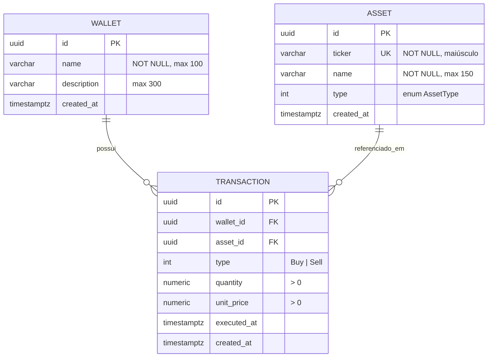

# Modelo de dados

**Posição** não é tabela: é calculada a partir das transações (fonte única da verdade, sem risco de saldo dessincronizado).

Índices: `assets(ticker)` único; `transactions(wallet_id, asset_id, executed_at)` para consultas de posição.
Chaves: UUID gerado pela aplicação. `numeric(18,6)` para quantidade e preço (nunca float para dinheiro).
